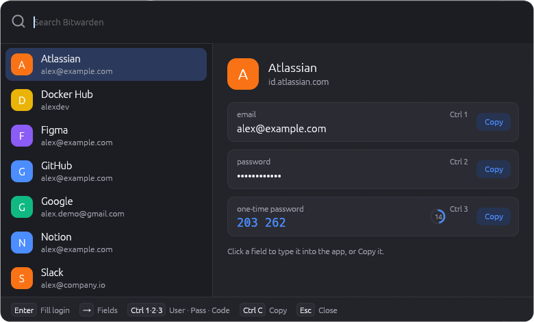
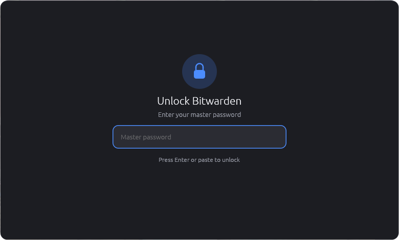

<div align="center">

# Quickwarden

**Quick access for Bitwarden on Windows and macOS.**
Press <kbd>Ctrl</kbd>+<kbd>Shift</kbd>+<kbd>Space</kbd> anywhere, find a login, and fill it into any app or website: no browser extension needed.

[](https://github.com/JaysonFrost/quickwarden/actions/workflows/ci.yml)
[](https://github.com/JaysonFrost/quickwarden/releases/latest)
[](LICENSE)


**English** · [Русский](README.ru.md)



</div>

## Why

Bitwarden is a great open-source password manager, but outside the browser extension there is no fast way to get a password into a desktop app, a game launcher, an RDP window or a terminal. Quickwarden is a small native companion that brings the "quick access" workflow known from other password managers to Bitwarden.

## Features

- **Global hotkey** <kbd>Ctrl</kbd>+<kbd>Shift</kbd>+<kbd>Space</kbd> opens a search window on top of whatever you are doing.
- **Autofill anywhere**: types the username, <kbd>Tab</kbd> and password into the window you came from, in any application.
- **Pick a single field**: fill or copy just the email, the password or the one-time code. <kbd>Ctrl</kbd>+<kbd>1</kbd> / <kbd>2</kbd> / <kbd>3</kbd> fill them instantly.
- **Built-in TOTP**: live two-factor codes with a countdown, computed locally from your Bitwarden TOTP secrets.
- **Context aware**: suggests logins for the website open in Chrome, Edge, Brave, Vivaldi, Opera, Firefox, Safari or Arc, or for the active app.
- **Windows Hello unlock**: after the first unlock, use your face, fingerprint or PIN instead of the master password.
- **Paste to unlock**: pasting the master password unlocks immediately.
- **Safe clipboard**: copied secrets are kept out of clipboard history and cleared after 30 seconds.
- **Native and small**: a single Rust binary, no Electron, no background web server.

<p align="center"></p>

## Installation

1. Install the official [Bitwarden CLI](https://bitwarden.com/help/cli/) and log in once:

   ```sh
   winget install Bitwarden.CLI          # Windows
   brew install bitwarden-cli            # macOS
   bw config server https://your.server  # self-hosted / Vaultwarden only
   bw login
   ```

2. Download Quickwarden from the [latest release](https://github.com/JaysonFrost/quickwarden/releases/latest):
   - **Windows**: `quickwarden-windows-x64.exe`. It is a single portable file. Windows SmartScreen may warn about an unsigned app: choose *More info* → *Run anyway*.
   - **macOS**: `quickwarden-macos-apple-silicon.zip` or `quickwarden-macos-intel.zip`. Unzip, move `Quickwarden.app` to Applications, right-click → *Open* the first time, then grant **Accessibility** in System Settings → Privacy & Security.

3. Run it, unlock with your master password, and press <kbd>Ctrl</kbd>+<kbd>Shift</kbd>+<kbd>Space</kbd> from any app.

To start Quickwarden at login: on Windows put a shortcut into `shell:startup`; on macOS add the app to System Settings → General → Login Items.

## Keyboard shortcuts

On macOS use <kbd>Cmd</kbd> instead of <kbd>Ctrl</kbd> inside the window.

| Shortcut | Action |
| --- | --- |
| <kbd>Ctrl</kbd>+<kbd>Shift</kbd>+<kbd>Space</kbd> | Open Quickwarden |
| Type | Search by name, username or website |
| <kbd>↑</kbd> <kbd>↓</kbd> | Choose a login, or a field in the field pane |
| <kbd>→</kbd> / <kbd>Tab</kbd> | Open the field pane |
| <kbd>Enter</kbd> | Fill username + password; in the field pane fill the selected field |
| <kbd>Shift</kbd>+<kbd>Enter</kbd> | Fill the password only |
| <kbd>Ctrl</kbd>+<kbd>1</kbd> / <kbd>2</kbd> / <kbd>3</kbd> | Fill username / password / one-time code |
| <kbd>Ctrl</kbd>+<kbd>C</kbd> | Copy the selected field |
| <kbd>Ctrl</kbd>+<kbd>H</kbd> | Unlock with Windows Hello |
| <kbd>Ctrl</kbd>+<kbd>L</kbd> | Lock |
| <kbd>Esc</kbd> | Back / hide |
| <kbd>Ctrl</kbd>+<kbd>Q</kbd> | Quit |

## How it works

- Your vault is read through the official Bitwarden CLI (`bw`). Quickwarden never talks to Bitwarden servers itself, so it works with bitwarden.com, Bitwarden EU, self-hosted Bitwarden and Vaultwarden.
- Decrypted logins stay only in memory and are dropped on lock, after 15 minutes of inactivity and on quit.
- Windows Hello protects the `bw` session key with AES-256-GCM under a key that only your Windows Hello credential (stored in the TPM) can produce. Your master password is never stored.
- No local HTTP server (`bw serve`) is used.

Details are in [SECURITY.md](SECURITY.md).

## Building from source

Requires [Rust](https://rustup.rs) 1.88 or newer.

```sh
git clone https://github.com/JaysonFrost/quickwarden
cd quickwarden
cargo build --release          # Windows: target/release/quickwarden.exe
./macos-bundle.sh              # macOS: target/Quickwarden.app
cargo test
```

## FAQ

**Does it work with Vaultwarden or a self-hosted server?**
Yes. Point the Bitwarden CLI at your server with `bw config server` before `bw login`.

**Does it replace the Bitwarden app or browser extension?**
No, it complements them. Quickwarden is for filling passwords quickly in places the extension cannot reach.

**Linux?**
Not yet. Pull requests are welcome.

## Contributing

Issues and pull requests are welcome. Please run `cargo fmt`, `cargo clippy --all-targets` and `cargo test` before opening a PR. Report security problems privately as described in [SECURITY.md](SECURITY.md).

## License

[MIT](LICENSE) © 2026 Igor Arnautov

Quickwarden is an independent project and is not affiliated with, endorsed by or sponsored by Bitwarden, Inc. "Bitwarden" is a trademark of Bitwarden, Inc.
