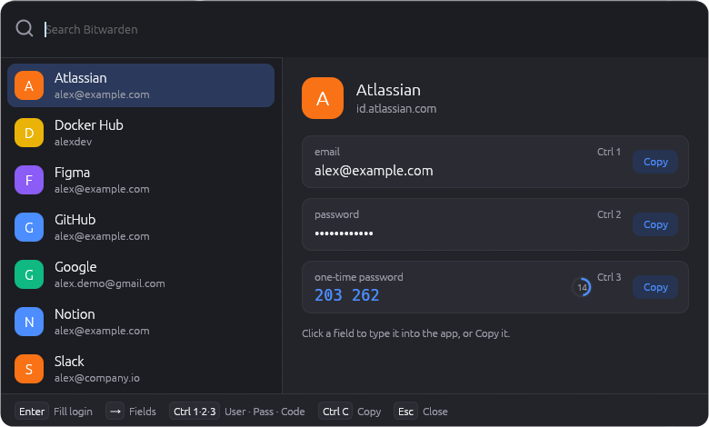
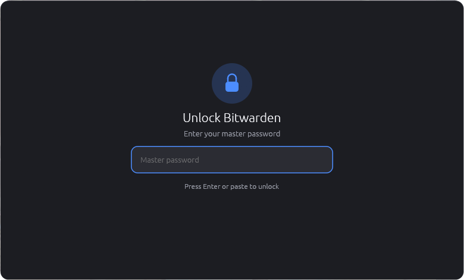

<div align="center">

# Quickwarden

**Быстрый доступ к Bitwarden на Windows и macOS.**
Нажмите <kbd>Ctrl</kbd>+<kbd>Shift</kbd>+<kbd>Space</kbd> в любой программе, найдите логин и подставьте его в любое приложение или сайт без браузерного расширения.

[](https://github.com/JaysonFrost/quickwarden/actions/workflows/ci.yml)
[](https://github.com/JaysonFrost/quickwarden/releases/latest)
[](LICENSE)


[English](README.md) · **Русский**



</div>

## Зачем

Bitwarden — отличный менеджер паролей с открытым кодом, но вне браузерного расширения нет быстрого способа вставить пароль в десктопное приложение, лаунчер игры, окно RDP или терминал. Quickwarden — небольшое нативное приложение, которое добавляет к Bitwarden режим «быстрого доступа», знакомый по другим менеджерам паролей.

## Возможности

- **Глобальная горячая клавиша** <kbd>Ctrl</kbd>+<kbd>Shift</kbd>+<kbd>Space</kbd> открывает окно поиска поверх любой программы.
- **Автозаполнение где угодно**: вводит логин, <kbd>Tab</kbd> и пароль в окно, из которого вы пришли, в любом приложении.
- **Отдельные поля**: можно ввести или скопировать только email, только пароль или только одноразовый код. <kbd>Ctrl</kbd>+<kbd>1</kbd> / <kbd>2</kbd> / <kbd>3</kbd> вводят их сразу.
- **Встроенный TOTP**: живые коды двухфакторной аутентификации с обратным отсчётом, считаются локально из TOTP-секретов Bitwarden.
- **Учёт контекста**: предлагает логины для сайта, открытого в Chrome, Edge, Brave, Vivaldi, Opera, Firefox, Safari или Arc, или для активного приложения.
- **Разблокировка Windows Hello**: после первой разблокировки вместо мастер-пароля используются лицо, отпечаток или PIN.
- **Разблокировка вставкой**: вставленный мастер-пароль сразу разблокирует хранилище, Enter не нужен.
- **Безопасный буфер обмена**: скопированные секреты не попадают в историю буфера и стираются через 30 секунд.
- **Нативно и компактно**: один бинарник на Rust, без Electron и без локального веб-сервера.

<p align="center"></p>

## Установка

1. Установите официальный [Bitwarden CLI](https://bitwarden.com/help/cli/) и один раз войдите:

   ```sh
   winget install Bitwarden.CLI          # Windows
   brew install bitwarden-cli            # macOS
   bw config server https://your.server  # только для self-hosted / Vaultwarden
   bw login
   ```

2. Скачайте Quickwarden из [последнего релиза](https://github.com/JaysonFrost/quickwarden/releases/latest):
   - **Windows**: `quickwarden-windows-x64.exe`. Это один переносимый файл. SmartScreen может предупредить о неподписанном приложении: нажмите *Подробнее* → *Выполнить в любом случае*.
   - **macOS**: `quickwarden-macos-apple-silicon.zip` или `quickwarden-macos-intel.zip`. Распакуйте, перенесите `Quickwarden.app` в «Программы», при первом запуске откройте через правый клик → *Открыть*, затем разрешите **Универсальный доступ** в Системных настройках → Конфиденциальность и безопасность.

3. Запустите, разблокируйте мастер-паролем и нажимайте <kbd>Ctrl</kbd>+<kbd>Shift</kbd>+<kbd>Space</kbd> в любой программе.

Автозапуск при входе: на Windows положите ярлык в `shell:startup`, на macOS добавьте приложение в Системные настройки → Основные → Объекты входа.

## Горячие клавиши

На macOS внутри окна вместо <kbd>Ctrl</kbd> используйте <kbd>Cmd</kbd>.

| Клавиши | Действие |
| --- | --- |
| <kbd>Ctrl</kbd>+<kbd>Shift</kbd>+<kbd>Space</kbd> | Открыть Quickwarden |
| Ввод текста | Поиск по названию, логину или сайту |
| <kbd>↑</kbd> <kbd>↓</kbd> | Выбрать логин или поле в панели полей |
| <kbd>→</kbd> / <kbd>Tab</kbd> | Открыть панель полей |
| <kbd>Enter</kbd> | Ввести логин и пароль; в панели полей — выбранное поле |
| <kbd>Shift</kbd>+<kbd>Enter</kbd> | Ввести только пароль |
| <kbd>Ctrl</kbd>+<kbd>1</kbd> / <kbd>2</kbd> / <kbd>3</kbd> | Ввести логин / пароль / одноразовый код |
| <kbd>Ctrl</kbd>+<kbd>C</kbd> | Скопировать выбранное поле |
| <kbd>Ctrl</kbd>+<kbd>H</kbd> | Разблокировать через Windows Hello |
| <kbd>Ctrl</kbd>+<kbd>L</kbd> | Заблокировать |
| <kbd>Esc</kbd> | Назад / скрыть |
| <kbd>Ctrl</kbd>+<kbd>Q</kbd> | Выйти |

## Как это работает

- Хранилище читается через официальный Bitwarden CLI (`bw`). Quickwarden сам не обращается к серверам Bitwarden, поэтому работает с bitwarden.com, Bitwarden EU, self-hosted Bitwarden и Vaultwarden.
- Расшифрованные логины хранятся только в памяти и удаляются при блокировке, после 15 минут бездействия и при выходе.
- Windows Hello защищает сессионный ключ `bw` шифрованием AES-256-GCM. Ключ шифрования может получить только ваша учётная запись Windows Hello, её закрытый ключ хранится в TPM. Мастер-пароль нигде не сохраняется.
- Локальный HTTP-сервер (`bw serve`) не используется.

Подробности — в [SECURITY.md](SECURITY.md).

## Сборка из исходников

Нужен [Rust](https://rustup.rs) 1.88 или новее.

```sh
git clone https://github.com/JaysonFrost/quickwarden
cd quickwarden
cargo build --release          # Windows: target/release/quickwarden.exe
./macos-bundle.sh              # macOS: target/Quickwarden.app
cargo test
```

## Вопросы и ответы

**Работает с Vaultwarden или своим сервером?**
Да. Перед `bw login` укажите сервер командой `bw config server`.

**Это замена приложению или расширению Bitwarden?**
Нет, это дополнение к ним. Quickwarden нужен, чтобы быстро вводить пароли там, куда расширение не дотягивается.

**Linux?**
Пока нет. Pull request'ы приветствуются.

## Участие в разработке

Issues и pull request'ы приветствуются. Перед PR запустите `cargo fmt`, `cargo clippy --all-targets` и `cargo test`. О проблемах безопасности сообщайте приватно, как описано в [SECURITY.md](SECURITY.md).

## Лицензия

[MIT](LICENSE) © 2026 Igor Arnautov

Quickwarden — независимый проект, он не связан с Bitwarden, Inc., не одобрен и не спонсируется ею. «Bitwarden» — товарный знак Bitwarden, Inc.
